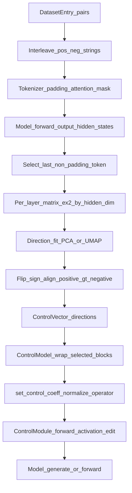

# DESIGN.md — Z_repeng / repeng

## Scope / what this doc covers

This repo is a **notebook-driven project** built around a **vendored copy of the `repeng` library** (representation engineering / “control vectors”) plus your experiment notebooks and data artifacts.

- **Library (source of truth)**: `repeng/repeng/` (Python package)
- **Experiments**: root `*.ipynb` and `repeng/notebooks/*.ipynb`
- **Artifacts / datasets**: `data/` and `repeng/notebooks/data/`

This doc is grounded in the code and notebooks in this workspace (not upstream docs).

## Repo layout (ownership boundaries)

### Root-level (project / experiments)

- `acid_trip.ipynb`, `acid_trip_recursive.ipynb`: train vectors on Mistral-7B-Instruct and run generation at different strengths; `acid_trip_recursive` returns the full output text to enable recursive loops.
- `repeng_test.ipynb`: heavier experimentation / debugging notebook (large; contains runs, errors, and notes).
- `ivar_load_vector.ipynb`: load a pre-trained `.gguf` control vector and apply it to a model locally (MPS/CPU path).
- `data/`
  - `true_facts.json`: suffix corpus used to build “fact-like” continuations for honesty-style datasets.
  - `control_vector.gguf`: a serialized `ControlVector` (GGUF container) used by `ivar_load_vector.ipynb`.
- `literature/`: PDFs / references.
- `ssh.txt`: local operational notes (not part of library behavior).

### Vendored library project under `repeng/`

This is an entire Python project (its own `pyproject.toml`, `README`, `LICENSE`, notebooks, tests).

- `repeng/repeng/`: actual package code
  - `__init__.py`: public exports
  - `control.py`: runtime steering mechanism (wrapping transformer blocks)
  - `extract.py`: training + GGUF serialization + vector algebra
  - `saes.py`: optional SAE integration (Eleuther SAE loader)
  - `tests.py`: behavioral tests / invariants
- `repeng/notebooks/`: canonical examples (vector ops, SAE, model-delta, large-model demos)
- `repeng/notebooks/data/`: bundled suffix corpora (`all_truncated_outputs.json`, etc.)

## Core concept

A **control vector** is a per-layer direction in hidden-state space. At inference time, the library injects that direction into selected transformer blocks’ outputs. At training time, the library learns directions from a *contrast dataset* of paired prompts:

- `DatasetEntry.positive`: prompt variant expressing attribute A
- `DatasetEntry.negative`: prompt variant expressing attribute ¬A

The library extracts hidden states for each (positive, negative) pair and learns a direction via PCA.

## Public API (package surface)

The package exports (from `repeng/repeng/__init__.py`):

- `ControlModel`
- `ControlVector`
- `DatasetEntry`

### `DatasetEntry`

`repeng/repeng/extract.py`

```python
@dataclasses.dataclass
class DatasetEntry:
    positive: str
    negative: str
```

Semantics: every entry defines a paired contrast; training treats the input list as pairs.

### `ControlVector`

`repeng/repeng/extract.py`

```python
@dataclasses.dataclass
class ControlVector:
    model_type: str
    directions: dict[int, np.ndarray]
```

Key methods:

- `ControlVector.train(model, tokenizer, dataset, **kwargs) -> ControlVector`
  - Learns `directions[layer_id]` for multiple layers.
- `ControlVector.train_with_sae(model, tokenizer, sae, dataset, *, decode=True, method="pca_center", **kwargs) -> ControlVector`
  - Same, but transforms hiddens through an SAE encoder (optionally decode back).
- `export_gguf(path)` / `import_gguf(path) -> ControlVector`
  - Serialization/interoperability.
- Vector algebra:
  - `+`, `-`, unary `-`, `*` scalar, `/` scalar

### `ControlModel`

`repeng/repeng/control.py`

Wraps (and **mutates**) a HuggingFace `PreTrainedModel` by replacing some transformer blocks with wrappers that can inject control.

Key methods:

- `ControlModel(model, layer_ids)`
  - Wrap selected layers. Accepts negative indexing (Python-style “from the end”).
- `set_control(control_vector, coeff=1.0, *, normalize=False, operator=...)`
  - Applies a `ControlVector` at strength `coeff` to all controlled layers.
- `set_raw_control({layer_id: tensor} | None, *, normalize=False, operator=...)`
  - Bypass `ControlVector` and set exact tensors per layer (or reset with `None`).
- `reset()`
  - Remove control from all controlled layers.
- `unwrap() -> PreTrainedModel`
  - Remove wrapper modules and return the base model.

## Internal architecture (modules and responsibilities)

### `repeng.control` (runtime steering)

#### `ControlModel`: wrapping and layer discovery

The wrapper uses `model_layer_list(model)` to locate the model’s transformer block list. It supports:

- explicit override: `model.repeng_layers = ModuleList(...)`
- implicit heuristics by suffix-match on module names:
  - `model.layers` (Llama/Mistral/Gemma/Qwen-style)
  - `transformer.h` (GPT-2 style)

Layer selection:

- The constructor accepts any iterable of `layer_ids`.
- It stores a normalized list `self.layer_ids` (converts negative indices to absolute indices).
- It mutates the underlying model’s layer list by replacing each selected layer with a `ControlModule(block)`.

#### `ControlModule`: injection point

`ControlModule.forward` calls the wrapped block, then conditionally modifies its output:

1. **Extract “activation tensor”**:
   - If the block output is a tuple, it modifies `output[0]` (common HF convention).
   - Else it treats the output itself as the activation tensor.
2. **Control tensor shaping**:
   - A 1D control vector is reshaped to `(1, 1, hidden_dim)` so it broadcasts across batch and sequence.
3. **Padding mask handling (left padding)**
   - If `position_ids` is present in the forward kwargs, it builds a mask intended to zero out left-padding positions (comment says “only tested this on left padding”).
   - If absent, mask is scalar `1.0` (no masking).
4. **Combine**:
   - `modified = operator(modified, control * mask)`; default operator is addition.
5. **Optional normalize**:
   - If `normalize=True`, it rescales `modified` to preserve the original per-token norm.

Operational implications:

- This works as a pure forward-time *activation edit* at specific blocks.
- Since it edits the block output, it is model-architecture dependent only in how blocks are located (`model_layer_list`); the injection is generic.

### `repeng.extract` (training + IO + vector ops)

#### Training pipeline: `ControlVector.train` → `read_representations`

At a high level:

- Build a training list of strings in interleaved order: `[pos0, neg0, pos1, neg1, ...]`.
- Run the model with `output_hidden_states=True`.
- For each sample, take the **last non-padding token** hidden state per layer.
- For each layer, learn a 1D direction (PCA component) from those vectors.
- Flip direction sign so positives project “larger” than negatives (majority vote over pairs).

Key knobs (`read_representations` kwargs):

- `hidden_layers: Iterable[int] | None`
  - Defaults to `range(-1, -model.config.num_hidden_layers, -1)`.
  - Important: for `num_hidden_layers = N`, that default yields `N-1` layers (it intentionally excludes the first block).
  - Negative indices are normalized against `len(model_layer_list(model))`.
- `batch_size: int = 32`
- `method: "pca_diff" | "pca_center" | "umap" = "pca_diff"`
  - `pca_diff`: train on pairwise differences \(h_{pos} - h_{neg}\)
  - `pca_center`: mean-center each pair (pos and neg) around their midpoint before PCA
  - `umap`: experimental, imports `umap` dynamically; direction is derived from 1D embedding weights
- `compute_hiddens: Callable | None`
  - Allows overriding how hidden states are computed (used in `repeng/notebooks/model_delta.ipynb` to compare two models).
- `transform_hiddens: Callable | None`
  - Post-process hidden matrices per layer (used by SAE training to encode into sparse feature space).

#### Hidden-state extraction: `batched_get_hiddens`

Properties:

- Tokenizes with `padding=True`, returns tensors on `model.device`.
- Calls model forward with `output_hidden_states=True`.
- For each sample, finds last non-padding token via `attention_mask[i].nonzero()[-1]`.
- For each requested `layer`:
  - chooses `hidden_idx = layer + 1 if layer >= 0 else layer`
  - then uses `out.hidden_states[hidden_idx][i][last_non_padding_index]`

Design intent:

- Layer numbering is aligned with HF’s `hidden_states` tuple indexing (embeddings at index 0, block outputs following).
- Negative indices let you refer to “from the end” layers without knowing model depth.

#### Direction sign selection

After computing a candidate direction, it projects all hiddens onto it and checks, over each (pos, neg) pair, whether pos is larger than neg. If “pos < neg” is more common than “pos > neg”, it flips the direction.

This makes the direction *oriented* so that positive examples move “forward” along the direction.

#### GGUF serialization format

`ControlVector.export_gguf(path)` writes:

- GGUF architecture: `controlvector`
- KV fields:
  - `controlvector.model_hint`: string (HF `config.model_type`)
  - `controlvector.layer_count`: uint32 (number of `directions`)
- Tensors:
  - `direction.{layer_id}`: numpy tensor for each key in `directions`

`ControlVector.import_gguf(path)` reads that back, warns if `general.architecture != "controlvector"`, requires `controlvector.model_hint`, then collects `direction.*` tensors.

### `repeng.saes` (optional SAE integration)

`saes.from_eleuther(repo_id, revision=None, device="cpu", dtype=bfloat16, layers=range(1, 32)) -> Sae`

Behavior:

- Dynamically imports `huggingface_hub`, `safetensors.torch`, and Eleuther’s `sae` library.
- Downloads an SAE snapshot, loads per-layer configs/weights, and returns a `Sae` containing layer objects with:
  - `encode(activation: np.ndarray) -> np.ndarray`
  - `decode(features: np.ndarray) -> np.ndarray`

Repeng vs Eleuther layer indexing:

- Repeng’s SAE loader expects `layers` to be **1-indexed** in “repeng style” (see docstring in `saes.py`), and converts to Eleuther indexing via `eleuther_layer = layer - 1`.

In `ControlVector.train_with_sae`:

- It encodes hiddens per requested layer into SAE feature space (`sae.layers[k].encode(v)`).
- It learns directions there (default method differs: `pca_center`).
- If `decode=True` (default), it decodes learned feature directions back to activation space so they can be used directly by `ControlModel`.

## End-to-end dataflow (training + apply)



## Notebook workflows (how this repo actually uses the library)

### Common pattern: dataset construction

The notebooks typically build suffix lists and then create datasets of chat-formatted prompts.

Data sources:

- `repeng/notebooks/data/all_truncated_outputs.json`: generic continuations used to produce many truncated suffixes. (Note: the root notebooks reference `data/all_truncated_outputs.json`, but this workspace currently only contains the vendored copy under `repeng/notebooks/data/`.)
- `data/true_facts.json` (or vendored notebook copies): fact-like statements used for “honesty”/world-knowledge style contrast.

Pattern:

1. Load suffix strings.
2. Tokenize each suffix and build many truncations (prefixes) to enlarge the training set.
3. Build `DatasetEntry` where each entry uses the same suffix, but different “persona” text in the prompt template.
4. Train:
   - `ControlVector.train(model, tokenizer, dataset, ...)`
5. Apply at inference:
   - `model.set_control(vector, coeff=...)`
   - `model.generate(...)`
   - `model.reset()`

### `acid_trip.ipynb` / `acid_trip_recursive.ipynb` (root)

- Loads `mistralai/Mistral-7B-Instruct-v0.1`
- Wraps control on layers `list(range(-5, -18, -1))` (a slice of later blocks).
- Trains multiple vectors (e.g., trippy, self-aware, creative) using default training settings.
- Uses a helper generator that prints:
  - baseline output (`model.reset()`)
  - positive coeff output
  - negative coeff output
- `acid_trip_recursive.ipynb` differs mainly in returning the full output text, enabling downstream loops (e.g., “train from generated content” style iteration).

### `ivar_load_vector.ipynb` (root)

- Loads Mistral-7B-Instruct locally.
- Chooses device `"mps"` if available else CPU; uses float16 on MPS.
- Imports a serialized vector:
  - `ControlVector.import_gguf("data/control_vector.gguf")`
- Applies it with `model.set_control(cv, coeff=1.0)` and generates.

### `repeng/notebooks/vector_ops.ipynb`

Demonstrates the vector algebra API:

- Combine traits: `happy_vector + honest_vector`
- Scale strength at the vector level: `2 * happy_vector`, `happy_vector / 2`
- Mix and match multiple traits: `0.7 * happy_vector + trippy_vector - 1.25 * honest_vector`

This is a pure convenience layer on top of per-layer numpy arrays (implemented by `ControlVector.__add__`, etc.).

### `repeng/notebooks/model_delta.ipynb`

Shows an important extension point: override hidden-state computation to learn “difference between two models on the same content”, rather than “difference between two prompts on the same model”.

- Defines `compute_hiddens(...)` that:
  - splits interleaved strings into A/B lists
  - calls `batched_get_hiddens` on `model_a` and `model_b` separately
  - interleaves the resulting matrices back into the expected `[a0, b0, a1, b1, ...]` layout
- Calls `ControlVector.train(..., compute_hiddens=compute_hiddens, method="pca_center")`

This works because `ControlVector.train` passes through `**kwargs` to `read_representations`.

### `repeng/notebooks/sae.ipynb`

Demonstrates SAE-enhanced training (feature-space directions):

- Installs Eleuther’s SAE library and loads an SAE from HF (`repeng.saes.from_eleuther(...)`).
- Trains:
  - `ControlVector.train_with_sae(..., decode=True)` (immediately usable in `ControlModel`)
  - `ControlVector.train_with_sae(..., decode=False)` (keeps directions in SAE feature space for inspection)

## Artifact map (inputs/outputs across workflows)

| Artifact | Location | Produced by | Consumed by | Meaning |
|---|---|---|---|---|
| `true_facts.json` | `data/true_facts.json` (also vendored copies under `repeng/notebooks/data/`) | external dataset (paper/blog lineage) | multiple notebooks (`acid_trip*`, `repeng/notebooks/experiments.ipynb`, `vector_ops.ipynb`, etc.) | suffix corpus used to create fact-like truncated continuations |
| `all_truncated_outputs.json` | `repeng/notebooks/data/all_truncated_outputs.json` | external dataset | notebooks (some root notebooks expect it at `data/all_truncated_outputs.json`) | generic continuation corpus used to synthesize many truncated suffixes |
| `control_vector.gguf` | `data/control_vector.gguf` | `ControlVector.export_gguf(...)` (notebook or script) | `ivar_load_vector.ipynb` | serialized vector (per-layer directions + model hint) |
| trained vectors (in-memory) | notebook variables | `ControlVector.train(...)` / `train_with_sae(...)` | `ControlModel.set_control(...)` | per-layer numpy directions used to steer generation |

## Performance model / scaling

Training cost is dominated by hidden-state extraction:

- Let:
  - \(N\) = number of dataset entries
  - \(L\) = number of layers you extract
  - \(D\) = hidden size
- The library processes \(2N\) strings (pos and neg).
- It stores only last-token hidden states per sample per layer (so memory is ~ \(2N \times L \times D\) floats across numpy arrays), but it still runs full forward passes with `output_hidden_states=True`.

Practical knobs:

- `batch_size`: reduce if you hit VRAM limits.
- `hidden_layers`: extract fewer layers if you want faster training or you’re exploring.
- `method`: `pca_center` can be more stable in some settings; notebooks commonly use both.

## Known assumptions / failure modes (from code comments + observed usage)

- **Wrapper mutates the model**: `ControlModel` replaces modules inside the model; you should treat the wrapped model instance as modified until `unwrap()`.
- **Layer discovery is heuristic**: unusual architectures may require setting `model.repeng_layers` manually.
- **Padding mask**: activation masking in `ControlModule` is only implemented when `position_ids` is passed and is explicitly “only tested on left padding”.
- **Default hidden-layer selection excludes one layer**: `read_representations` default range yields `num_hidden_layers - 1` layers; this is deliberate (tests rely on it), but it’s a design choice worth knowing.
- **MoE caveat**: the vendored `repeng/README.md` notes vector training currently does not work with MoE models (e.g., Mixtral).

## Extension points (intended customization hooks)

- **Override layer list**:
  - `model.repeng_layers = torch.nn.ModuleList([...])` to make `model_layer_list` deterministic.
- **Custom combination rule**:
  - `ControlModel.set_control(..., operator=my_op)` where `my_op(current, control) -> tensor`.
- **Norm preservation**:
  - `normalize=True` rescales the post-edit activation to match pre-edit norm.
- **Custom hidden extraction**:
  - `ControlVector.train(..., compute_hiddens=...)` to train on model-vs-model differences, alternative pooling, caching, etc.
- **Feature-space training**:
  - `train_with_sae(..., decode=False)` keeps directions in SAE space for introspection; decode later if desired.

## Behavioral note (capability / risk, stated non-procedurally)

The notebooks demonstrate that sufficiently strong activation steering can materially change model behavior and override “intended” response styles. Treat control strength (`coeff`) as a high-leverage parameter and test behaviors at the strengths you intend to ship.

